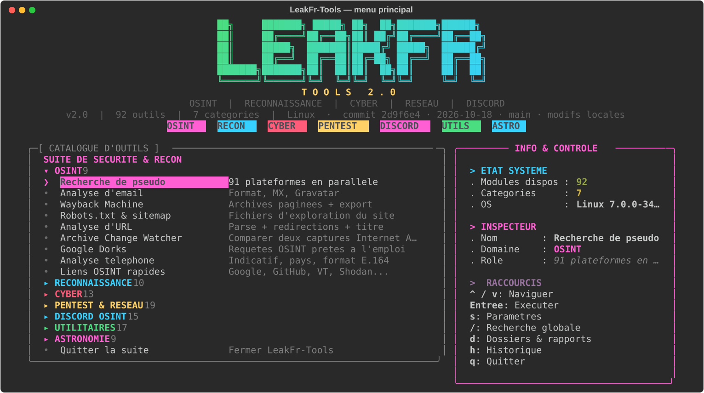
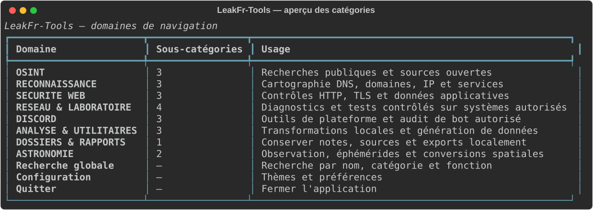

<div align="center">

# LeakFr-Tools

### OSINT · Reconnaissance · Cyber · Réseau · Discord · Astronomie

**82 outils · 8 domaines de navigation · recherche globale intégrée**

[](https://www.python.org/)
[](https://github.com/Textualize/rich)
[](#)

</div>

---

## Présentation

LeakFr-Tools est une boîte à outils Python en ligne de commande pour les recherches en sources ouvertes, la reconnaissance technique, les contrôles de sécurité, les diagnostics réseau et quelques utilitaires pratiques. L’interface repose sur Rich ; les préférences et dossiers d’investigation sont stockés localement.

> Les résultats dépendent des sources, des permissions et de la disponibilité des services externes. Ce dépôt ne promet pas qu’un outil fonctionne sur toutes les cibles ni qu’un résultat constitue une preuve.

## Captures d’écran

Les images ci-dessous sont des rendus de l’interface terminal fournis avec le dépôt (pas des captures d’un navigateur ou d’une connexion réelle). Elles illustrent le menu hiérarchique et les outils. Chaque guide de module contient un visuel statique.

| Menu principal | Vue des catégories |
|---|---|
|  |  |

## Navigation & guides des outils

Le menu regroupe les 82 outils existants et nouveaux en domaines fonctionnels, puis en sous-catégories ; les fonctions restent référencées par leur catalogue de modules d’origine. Les dossiers d’investigation, la configuration et la recherche globale sont des destinations transverses.

| Domaine dans le menu | Guides des modules |
|---|---|
| OSINT | [modules/osint/README.md](modules/osint/README.md) |
| Reconnaissance | [modules/recon/README.md](modules/recon/README.md) |
| Sécurité Web | [modules/cyber/README.md](modules/cyber/README.md) |
| Réseau & laboratoire | [modules/pentest/README.md](modules/pentest/README.md) |
| Discord | [modules/discord/README.md](modules/discord/README.md) |
| Analyse & utilitaires | [modules/utils/README.md](modules/utils/README.md) |
| Dossiers & rapports | dossiers SQLite, notes, sources, historique et export JSON dans `data/` |
| Astronomie | [modules/astro/README.md](modules/astro/README.md) |

La recherche globale indexe le nom, la description, le domaine et des alias fonctionnels (par exemple `tls`, `courriel`, `fuzzing` ou `subnet`). Chaque résultat montre son chemin et permet d’ouvrir l’outil directement. `Échap` annule/revient d’un niveau ; `Menu principal` remonte à la racine.

### En un coup d’œil

- **OSINT** : profils, e-mails, archives, domaines et recherche publique.
- **Reconnaissance** : DNS, domaines, IP/ASN, WHOIS et services Web.
- **Sécurité Web** : HTTP, TLS, cookies, JWT, CVE, CORS et réputation.
- **Réseau & laboratoire** : connectivité, protocoles et tests actifs réservés aux cibles autorisées.
- **Discord** : données publiques, bots autorisés et webhooks.
- **Analyse & utilitaires** : hashes, encodage, conversions, dates et corpus synthétiques.
- **Dossiers & rapports** : investigations locales, journal et exports JSON.
- **Astronomie** : ISS, APOD, astéroïdes, planètes et conversions spatiales.

## Pistes de développement spécialisées

Ces pistes évitent de dupliquer les scanners/lookup existants et privilégient les workflows de laboratoire. Le **corpus de cas limites HTTP** est le premier outil de cette série, disponible dans Analyse & utilitaires ; il produit des fixtures JSON locales et n’envoie aucun paquet.

1. **Differential HTTP Bench** — comparer plusieurs serveurs/proxy locaux sur les mêmes fixtures ; détecte les divergences de parsing plutôt qu’une vulnérabilité au hasard.
2. **API Contract Mutator** — dériver des cas limites d’un schéma OpenAPI local avec validations reproductibles, au lieu de scanner des endpoints inconnus.
3. **HTTP Edge Corpus** — corpus déterministe de valeurs limites (doublons, CRLF, encodage, framing) pour parseurs/labs ; implémenté, réseau désactivé.
4. **WebSocket Frame Studio** — générer, visualiser et rejouer des trames fragmentées/contrôle contre un endpoint loopback configuré.
5. **Protocol State Simulator** — serveur TCP local pilotable par scénarios pour tester les machines à états des clients.
6. **TLS Policy Diff** — comparer deux snapshots locaux de certificats/ciphers et signaler les changements de configuration.
7. **Cookie Scope Matrix** — simuler Domain/Path/SameSite/Secure avec des profils de navigateur synthétiques.
8. **CORS Regression Matrix** — transformer une politique déclarée en cas de tests et comparer les réponses à un serveur de test possédé.
9. **Loopback SSRF Sink** — récepteur local contrôlé pour observer les callbacks d’un labo, sans infrastructure externe.
10. **JWT Negative-Test Bench** — fabriquer des variantes invalides pour vérifier le rejet côté application ; aucune validation de tokens de tiers.
11. **DNS Wire Parser Corpus** — produire des réponses DNS tronquées, compressées ou malformées pour valider des parseurs locaux.
12. **SMTP STARTTLS Verifier** — tester les transitions TLS et commandes SMTP contre un serveur de laboratoire.
13. **OAuth Redirect Auditor** — valider hors-ligne les URI de retour et scénarios d’état/PKCE depuis une configuration fournie.
14. **CSP Policy Evaluator** — analyser une politique CSP avec résultats structurés et exemples de régression, sans injection distante.
15. **Request Framing Lab** — exécuter des scénarios Content-Length/Transfer-Encoding exclusivement sur un service loopback explicite.
16. **URL Canonicalization Diff** — comparer normalisation Unicode, encodage et chemins entre bibliothèques locales pour repérer les interprétations divergentes.
17. **GraphQL Schema Drift** — comparer des snapshots introspection fournis par l’utilisateur et repérer les changements de contrat.
18. **Evidence Chain Ledger** — lier fichiers, horodatages et SHA-256 pour rendre un dossier d’audit local vérifiable.
19. **Synthetic Identity Pack** — générer des données fictives cohérentes pour tester formulaires, pipelines et détecteurs sans données personnelles.
20. **Stateful Agent Loopback** — émuler beacon/check-in d’agents de test vers un serveur local avec journaux explicites, sans persistance ni commande système.
21. **TCP Replay Fixture** — rejouer des conversations enregistrées vers un socket local pour reproduire des bogues protocolaires.
22. **Regex Backtracking Bench** — mesurer des motifs fournis sur des entrées générées en sandbox avec limites strictes de taille/temps.
23. **Wordlist Mutation Profiles** — créer des profils de transformations déterministes et mesurer couverture/dédoublonnage sur un dataset synthétique.
24. **Archive Change Watcher** — comparer des snapshots Wayback fournis/collectés et produire une chronologie de changements documentée.
25. **Finding Correlator** — relier observations, sources et notes d’un dossier sans transformer automatiquement un indice en vulnérabilité confirmée.

Les nouvelles intégrations devraient conserver un mode hors-ligne et un mode de laboratoire explicite ; aucun test actif ne doit viser une cible sans autorisation.

## Sélection d’un outil

Le menu principal offre les huit domaines, la recherche globale, la configuration et la sortie. Un domaine ouvre ses sous-catégories ; chaque outil affiche son chemin, une description courte et des options de retour.

| Touche/action | Effet |
|---|---|
| Flèches haut/bas + Entrée | Parcourir et sélectionner dans chaque menu |
| Échap | Revenir au niveau précédent / annuler |
| Menu principal | Remonter directement à la racine |
| Recherche globale | Rechercher par nom, catégorie ou fonction puis lancer le résultat |
| Ctrl-C | Annuler la sélection ou quitter proprement |

`--simple` garde la même hiérarchie en sélection textuelle pour les terminaux non interactifs.

## Démarrage & navigation

## Installation

### Prérequis

- Python 3.9 ou supérieur (testé ici avec Python 3.14)
- pip
- Un terminal compatible avec Rich
- Internet pour les modules qui interrogent des services externes

```bash
git clone https://github.com/darkerorr/LeakFr-Tools.git
cd LeakFr-Tools
python3 -m venv .venv
source .venv/bin/activate       # Windows PowerShell : .venv\Scripts\Activate.ps1
python -m pip install -r requirements.txt
```

## Démarrage & navigation

```bash
python3 main.py
```

Le menu propose une hiérarchie domaine → sous-catégorie → outil, avec recherche globale, configuration et dossiers/rapports. Utilisez les flèches et Entrée ; Échap remonte d’un niveau et Ctrl-C annule proprement. Dans un terminal non interactif, le menu textuel reprend la même hiérarchie.

```bash
python3 main.py --help       # aide CLI
python3 main.py --version    # version affichée
python3 main.py --simple     # forcer les menus textuels
python3 main.py --ascii      # affichage compatible ASCII
```

## Configuration et données locales

Le fichier `data/settings.json` est créé au premier démarrage. Le menu **Paramètres** permet de choisir le style (dashboard, classique, compact), une palette, les couleurs d’accent/texte/fond de shell, la largeur, le panneau latéral, les badges, la bannière, les animations et le timeout réseau (1–120 s). Une palette entièrement personnalisable par rôle est disponible et les préférences persistent dans `data/settings.json`. Les dossiers d’investigation utilisent SQLite (`data/cases.db`), avec historique (`data/history.json`) et exports (`data/exports/`). Les données collectées peuvent être sensibles : vérifiez les exports avant partage.

## Tests & vérifications

Depuis la racine du dépôt :

```bash
python3 -m compileall -q .
python3 -m pytest -q
python3 main.py --help
```

Les utilitaires, dont le corpus de cas limites HTTP, fonctionnent localement sans dépendance supplémentaire. Le corpus produit uniquement des fixtures JSON (aucune requête réseau). Le générateur de mots de passe masque le secret par défaut ; l’affichage ou la copie au presse-papiers sont des choix explicites.

Les tests automatisés couvrent les helpers locaux, les réglages visuels et les rendus d’interface ; ils ne font aucun appel réseau réel. Les fonctionnalités en ligne nécessitent des tests d’intégration séparés avec des comptes de test, des clés appartenant à l’utilisateur et des cibles explicitement autorisées.

## Dépendances

| Paquet | Usage |
|---|---|
| [Requests](https://requests.readthedocs.io/) | Requêtes HTTP |
| [Rich](https://github.com/Textualize/rich) | Interface terminal |
| [Pygments](https://pygments.org/) | Dépendance de coloration Rich |

Le reste utilise la bibliothèque standard (SQLite, sockets, TLS, JSON, argparse). Certaines fonctions dépendent d’outils système ou d’APIs tierces.

## Utilisation responsable & sécurité

- N’utilisez les tests actifs que sur vos systèmes ou avec une autorisation explicite.
- Respectez les lois, règles des plateformes et limites de requêtes.
- N’utilisez jamais de token utilisateur Discord. Les tokens de bot sont secrets : ne les collez pas dans une issue, un log ou un commit ; révoquez-les immédiatement s’ils sont exposés.
- Le panneau Discord demande une confirmation avant les actions qui modifient le serveur. N’accordez au bot que les permissions strictement nécessaires.
- Une recherche négative n’est pas une preuve d’absence ; une correspondance peut être erronée ou obsolète.

**L’utilisateur est responsable de ses actions et des cibles interrogées.**

## Contribuer

Pour signaler un bug : joignez les étapes de reproduction, Python/OS, le résultat attendu et l’erreur pertinente après avoir retiré les secrets. Pour toute modification, exécutez les tests et évitez d’ajouter des données de comptes ou d’investigation.

## Licence

Aucun fichier `LICENSE` n’est présent dans le dépôt. Ne présumez pas qu’une licence libre autorise la redistribution ou la réutilisation.
