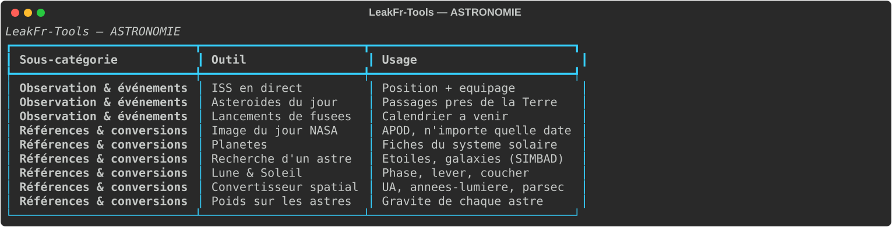
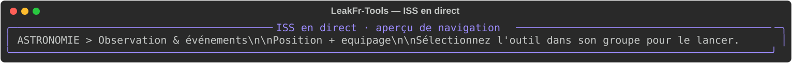
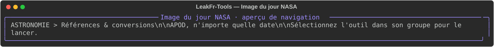
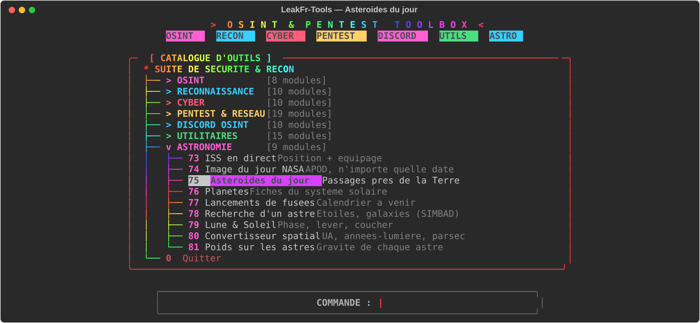
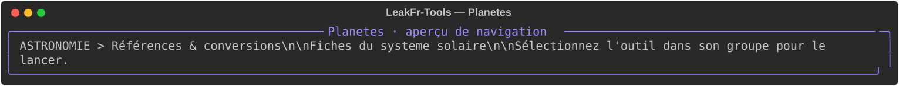
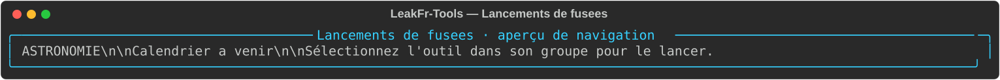
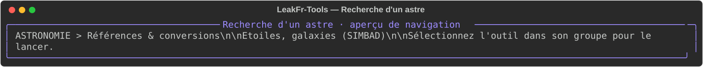
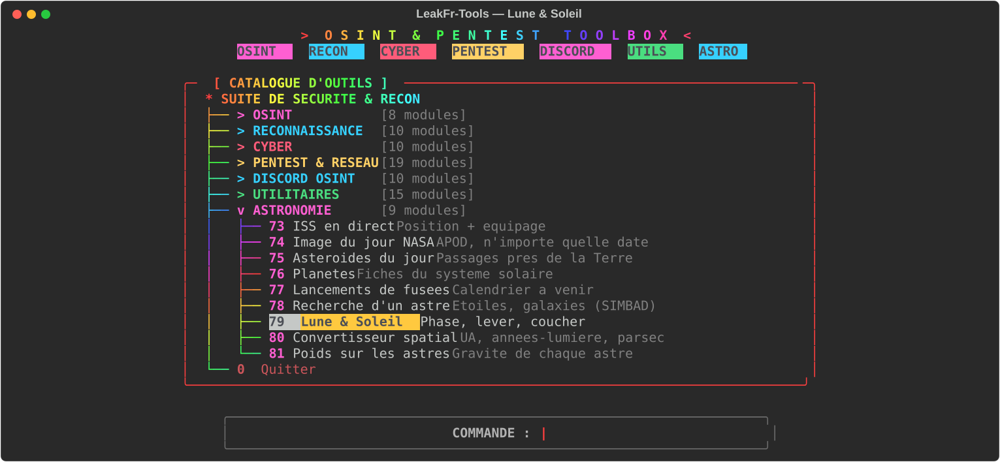
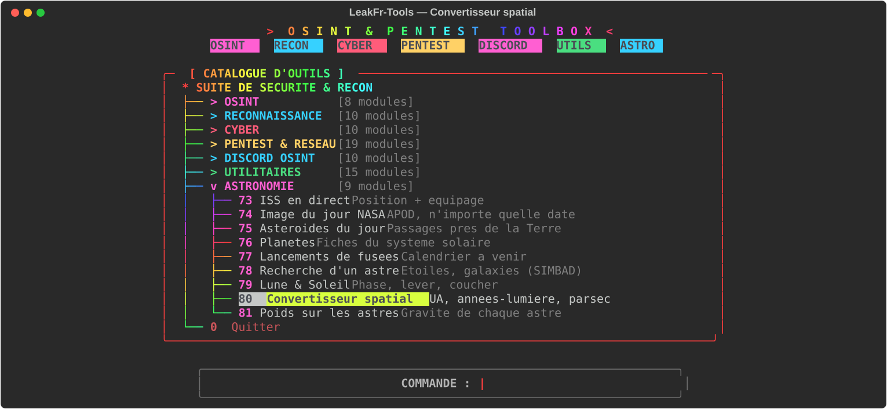
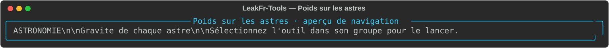

# Astronomie — données et conversions spatiales

Cette catégorie rassemble des fiches et services de données astronomiques. Certains outils ont besoin d’internet ; les valeurs et dates peuvent dépendre des fournisseurs.

| Outil | Fonction | Aperçu |
|---|---|---|
| ISS en direct | Consulte la position et des données disponibles sur l’ISS. |  |
| Image du jour NASA | Consulte l’APOD, éventuellement pour une date donnée. |  |
| Astéroïdes du jour | Affiche des objets proches de la Terre selon la source utilisée. |  |
| Planètes | Présente des fiches synthétiques des planètes. |  |
| Lancements de fusées | Consulte un calendrier de lancements à venir. |  |
| Recherche d’un astre | Recherche des objets célestes dans une source astronomique. |  |
| Lune & Soleil | Affiche des informations de phase ou d’horaires disponibles. |  |
| Convertisseur spatial | Convertit UA, années-lumière et parsecs. |  |
| Poids sur les astres | Compare le poids théorique selon la gravité indiquée. |  |

## Utilisation

Lancez `python3 main.py` puis ouvrez **ASTRONOMIE**. Les résultats en ligne ne sont pas garantis sans accès aux services concernés.

Les visuels sont des aperçus statiques du menu ; ils n’illustrent pas une mesure réelle.
