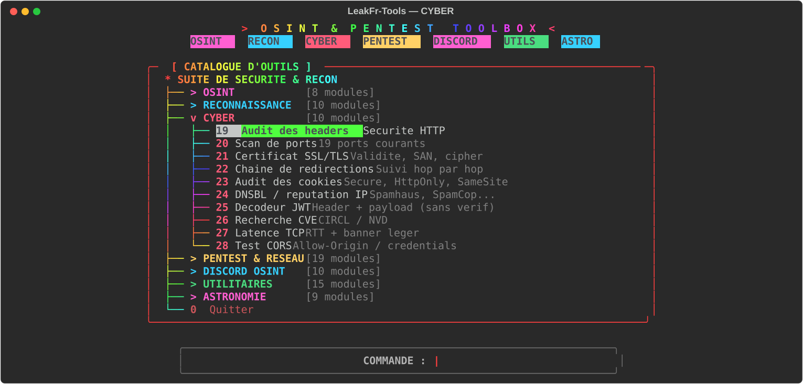
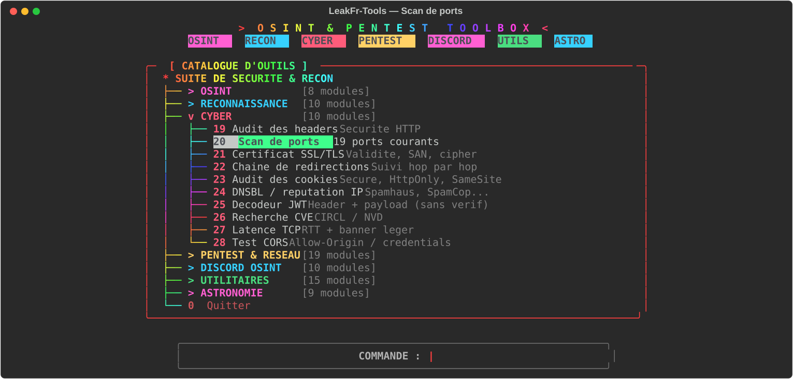
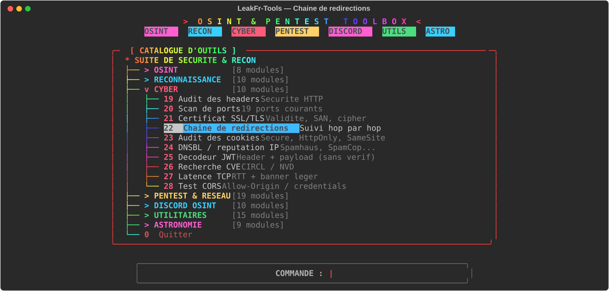
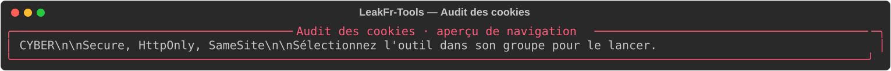
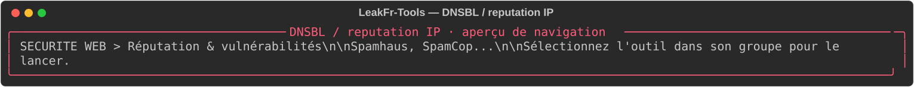
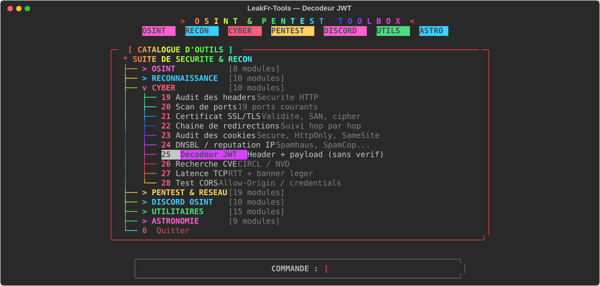
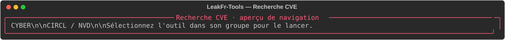
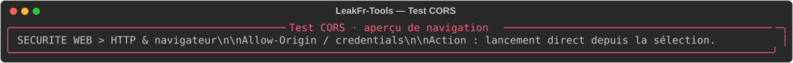

# Cyber — contrôles de sécurité

Contrôles HTTP/TLS et inspection locale de données fournies par l’utilisateur. Ils donnent des indications et ne remplacent ni un audit professionnel ni une validation manuelle.

| Outil | Fonction | Aperçu |
|---|---|---|
| Audit des headers | Vérifie des en-têtes de défense HTTP courants. |  |
| Scan de ports | Contrôle une sélection de ports TCP courants. |  |
| Certificat SSL/TLS | Affiche validité et éléments du certificat présenté. |  |
| Chaîne de redirections | Suit les redirections HTTP rencontrées. |  |
| Audit des cookies | Signale les attributs Secure, HttpOnly et SameSite. |  |
| DNSBL / réputation IP | Consulte des listes publiques de réputation. |  |
| Décodeur JWT | Décode l’en-tête et le payload **sans vérifier la signature**. |  |
| Recherche CVE | Recherche des entrées CVE via les sources disponibles. |  |
| Latence TCP | Mesure une connexion TCP et éventuellement une bannière légère. |  |
| Test CORS | Observe les en-têtes CORS renvoyés par une cible. |  |

## Utilisation

Lancez `python3 main.py` puis choisissez **CYBER**. Pour les tests réseau, ne ciblez que vos propres systèmes ou un actif explicitement autorisé. Ne partagez pas les JWT ou données qui y sont encodées.

Les illustrations sont des aperçus statiques du menu, et non des résultats d’audit.
