# Discord — panel Bot, clonage, médias et profil

Quatre expériences distinctes, complémentaires :

- **Panel Bot** : administration d’un bot que vous contrôlez, via son token Bot et une Gateway `discord.py`.
- **Server Cloner / Emoji Cloner** : copie de structure et transfert d’emojis entre serveurs autorisés, avec simulation, manifestes et rapports réels.
- **GIF Studio / Profile Studio** : bibliothèque locale de médias et préparation de profil, sans selfbot ni fausse application de compte.
- **Discord Personal Panel** : profil et serveurs accessibles via OAuth2 officiel, plus des outils locaux utilisables hors ligne.

Aucun outil du dépôt n’accepte de token utilisateur copié manuellement. Les self-bots restent hors périmètre. Les tokens Bot sont des secrets : ils ne sont jamais écrits dans les journaux, exports ou captures.

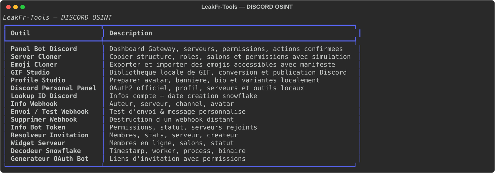

| Outil | Fonction | Aperçu |
|---|---|---|
| Panel Bot Discord | Dashboard, serveurs, permissions effectives, clonage, communication, salons, rôles, webhooks, modération confirmée et journal local. | 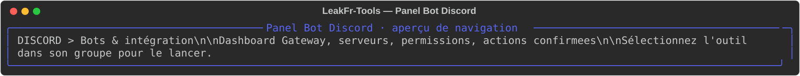 |
| Server Cloner | Exporte un manifeste, simule puis recrée rôles, catégories, salons et permissions autorisées. | 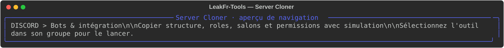 |
| Emoji Cloner | Télécharge, vérifie et importe des emojis animés/statiques avec manifeste de résultats. | 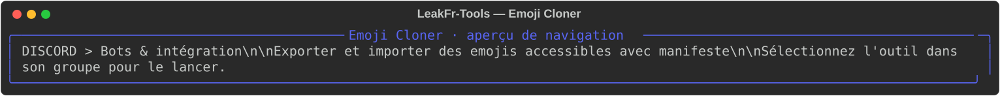 |
| GIF Studio | Bibliothèque locale, doublons SHA-256, conversion et publication Discord distincte. | 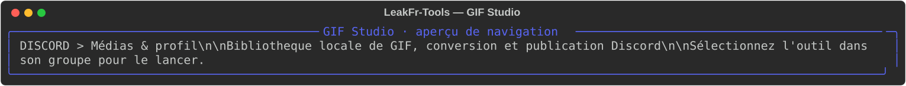 |
| Profile Studio | Avatars, bannières, bios et variantes locales ; application manuelle uniquement. | 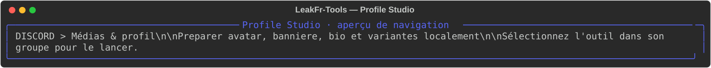 |
| Discord Personal Panel | OAuth2 officiel (`identify`, `guilds`), profil, liste de serveurs et outils locaux. | 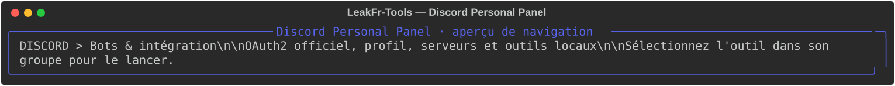 |
| Lookup ID Discord | Affiche les informations publiques associées à un identifiant. | 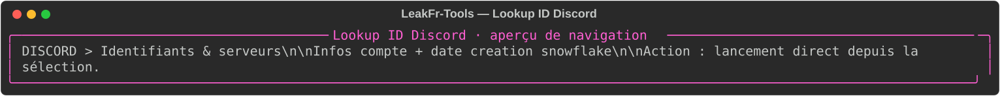 |
| Info Webhook | Consulte les métadonnées visibles d’un webhook donné. | 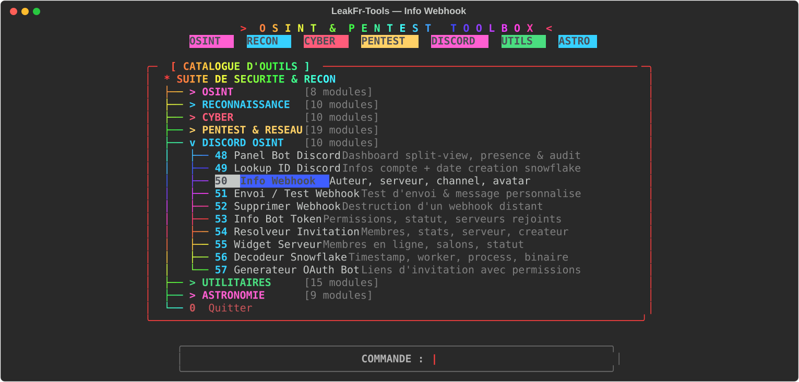 |
| Envoi / Test Webhook | Envoie un message de test via un webhook que vous contrôlez. | 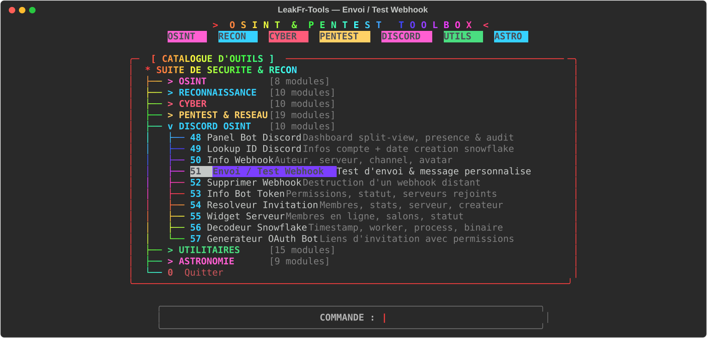 |
| Supprimer Webhook | Supprime le webhook fourni après confirmation. | 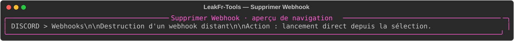 |
| Info Bot Token | Vérifie des informations disponibles sur votre bot. | 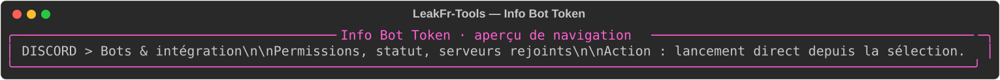 |
| Resolveur Invitation | Consulte les informations publiques d’une invitation. | 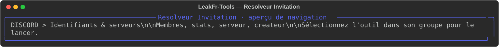 |
| Widget Serveur | Consulte le widget public d’un serveur lorsque celui-ci est activé. |  |
| Décodeur Snowflake | Convertit un identifiant Discord en timestamp et composants techniques. | 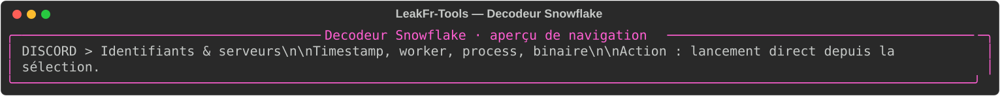 |
| Générateur OAuth Bot | Prépare un lien d’installation et des permissions OAuth choisies. | 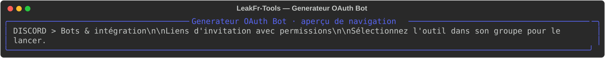 |

## Panel Bot

Le panel s’appuie sur :

- `discord.py` pour la Gateway (heartbeats, reconnexion, session unique) ;
- un client REST commun qui respecte les `429` (avec `retry_after`), borne les délais et distingue `401`, `403`, `404` et `5xx` ;
- un calcul de permissions effectives : `@everyone`, rôles cumulés, Administrateur, propriétaire, puis surcharges du salon (tout le monde, rôles, membre).

### Dashboard

Identité et ID du bot, état de la Gateway, latence, durée de session, nombre de serveurs accessibles, intents réellement demandés (`guilds` uniquement), dernière erreur, serveur ciblé et dernières actions du journal. Une valeur indisponible est affichée « — » ou « non communiqué », jamais inventée.

### Groupes d’actions

- **Serveurs & permissions** : recherche par nom/ID, détails, salons et catégories, rôles, surcharges de permissions, webhooks, membres chargés (**maximum 100**, liste tronquée signalée), permissions effectives, modification du surnom du bot, invitation temporaire (1 h, 1 usage) et export JSON.
- **Clonage Discord** : accès direct au Server Cloner et à l’Emoji Cloner avec la session du panel.
- **Communication** : message avec aperçu, envoi de fichier (10 Mio max), embed avec aperçu, annonce sans mention de masse, sondage (2 à 10 réponses), modèles locaux.
- **Salons & catégories** : création, modification (nom, sujet, NSFW, mode lent), déplacement, catégorie ; listes paginées au-delà de 25 entrées. Chaque changement est prévisualisé puis confirmé.
- **Webhooks** : liste, création (URL secrète affichée une seule fois, jamais journalisée) et suppression à double confirmation, avec vérification de `Gérer les webhooks`.
- **Rôles** : exploration, comparaison, permissions critiques, hiérarchie, création, suppression à double confirmation, modification (nom, couleur, permissions) si le bot est au-dessus du rôle.
- **Modération** : fiche membre, timeout (1 à 40 320 minutes), expulsion avec double confirmation. Le propriétaire, les bots et les cibles au-dessus du bot sont refusés. Chaque tentative, réussie ou non, est journalisée localement.
- **Connexion & présence** : démarrage/arrêt explicite de la Gateway, présence validée, actualisation.

## Server Cloner

Le panel Bot et l’entrée catalogue **Server Cloner** utilisent le même code (`modules/discord/cloner/`) : il n’existe pas de second panel concurrent.

1. Le manifeste est lu depuis l’API officielle : rôles non gérés, catégories, salons textuels/vocaux/annonces/stage/forum/media, sujet, mode lent, bitrate, limite d’utilisateurs, tags de forum et surcharges de permissions.
2. Le plan compare le manifeste à la destination, applique la stratégie `ignorer` ou `renommer`, permet d’exclure des rôles ou salons précis, mappe `@everyone` vers le serveur cible, associe les rôles existants par nom et bloque les créations au-dessus de la hiérarchie du bot.
3. Le mode simulation affiche exactement les créations, éléments existants, blocages et surcharges ignorées ; il n’écrit rien.
4. L’exécution réelle demande deux confirmations, vérifie `Gérer les salons` et `Gérer les rôles`, crée dans l’ordre rôles → catégories → salons, puis écrit un rapport JSON sous `data/exports/`.
5. Une erreur partielle, une limite de débit persistante ou une annulation donne un statut `partiel`/`annule` ; l’outil ne prétend jamais que le serveur est entièrement cloné.

Non copiés par conception : membres, messages, webhooks, jetons, rôles d’intégration (`managed`) et surcharges visant un membre. Les positions exactes des rôles ne sont pas forcées ; l’ordre relatif est recréé par l’ordre de création, sous la hiérarchie du bot.

## Emoji Cloner

- Source et destination sont deux serveurs accessibles au bot ; les emojis sont listés via `GET /guilds/{id}/emojis`.
- Chaque fichier est téléchargé uniquement depuis le CDN Discord, contrôlé par signature (PNG/GIF/JPEG), taille (256 Kio) et format ; WebP est refusé car non accepté à l’import.
- Les noms sont normalisés (`[A-Za-z0-9_]`, 2–32 caractères), les conflits peuvent être ignorés ou renommés avec suffixe, et la capacité du serveur (selon le niveau de boost) est vérifiée avant l’import. Une prévisualisation d’un emoji téléchargé est proposée avant confirmation.
- L’import utilise `POST /guilds/{id}/emojis` avec data-URI. Chaque réponse est vérifiée : un emoji refusé reste une erreur et n’est pas compté comme importé.
- L’export écrit les fichiers et un manifeste ; l’import d’un manifeste vérifie que les fichiers existent encore. Aucun jeton n’est écrit dans les manifestes.

Permission requise : `Gérer les emojis` (et l’accès en lecture au serveur source).

## GIF Studio

- Import local ou URL http(s) publique ; les adresses privées, locales ou réservées et les schémas non http(s) sont refusés. Les redirections sont revalidées.
- Détection par signature et décodage Pillow ; taille maximale 10 Mio ; les doublons sont détectés par SHA-256 et réutilisés.
- Aperçu terminal de l’animation, conversion GIF ↔ WebP ↔ PNG/APNG, copie vers un chemin choisi, suppression locale confirmée.
- La publication Discord est une action séparée : le bot doit avoir `Envoyer des messages` et `Joindre des fichiers` dans le salon. Un échec d’upload n’est jamais présenté comme un enregistrement local réussi, et inversement.

## Profile Studio

Le studio prépare localement des avatars (512×512), des bannières (960×540), des bios (190 caractères), des noms affichés (32) et des statuts (128). Il conserve plusieurs variantes, les compare, garde un historique et exporte/importe du JSON.

**Limite réelle :** l’API officielle Discord ne permet pas à une application de modifier le profil d’un compte utilisateur. Le studio n’a donc aucun bouton « Appliquer », ne demande aucun token utilisateur et n’utilise pas de selfbot. Il ouvre les paramètres officiels (`discord.com/settings/profile`, etc.) et explique l’application manuelle. Un bot ne peut modifier que son propre profil de bot.

### Limites honnêtes

- Les intents privilégiés `members` et `message_content` ne sont pas demandés. La liste des membres vient d’un appel REST limité à 100 entrées ; ce n’est pas un audit exhaustif.
- Les webhooks ne sont listés que si le bot possède `Gérer les webhooks` ; le jeton d’un webhook créé est affiché une seule fois, à la demande, et n’est jamais journalisé ni exporté.
- Les actions restent soumises aux permissions et à la hiérarchie réelles de Discord. Le panel vérifie avant d’envoyer, mais l’API reste l’autorité finale.
- Le journal local (`data/discord_panel_journal.json`) est un aide-mémoire, pas une preuve opposable.

## Discord Personal Panel

Le panel personnel utilise uniquement le flux OAuth2 officiel **authorization code + PKCE**.

- Scopes demandés : `identify` et `guilds`, rien de plus.
- Le client ID provient de `DISCORD_CLIENT_ID` ou de `data/discord_oauth.json` (permissions `600`). Le client secret est facultatif pour un client public PKCE.
- Déclarez l’URI de redirection exacte (`http://127.0.0.1:8765/callback` par défaut) dans le portail développeur Discord ; une URI différente doit être configurée des deux côtés.
- Le jeton d’accès reste **en mémoire** ; il n’est pas écrit dans les préférences ni l’historique. La déconnexion tente une révocation officielle.
- Aucun mot de passe, token utilisateur ou jeton de session n’est demandé.

Fonctions réellement disponibles :

- profil autorisé (scope `identify`) ;
- liste des serveurs accessibles avec le scope `guilds`, recherche, tri et sélection ;
- ouverture du panel Bot avec le serveur présélectionné (le bot doit y être installé ; ses permissions sont vérifiées ensuite) ;
- outils locaux hors ligne : décodage de Snowflake, liens d’invitation/application, aperçu de message et d’embed, modèles ;
- préférences non sensibles et historique local dans `data/discord_personal.json`.

Limites : OAuth2 ne permet pas d’envoyer des messages, gérer des salons ou modérer à la place d’un compte utilisateur. Ces opérations restent dans le panel Bot, avec un token Bot. Le panel ne peut pas déterminer à lui seul si le bot est installé sur un serveur : cette vérification a lieu à l’ouverture du panel Bot.

## Configuration et secrets

| Donnée | Emplacement | Protection |
|---|---|---|
| Client ID / secret OAuth2 | `DISCORD_CLIENT_ID` / `DISCORD_CLIENT_SECRET` ou `data/discord_oauth.json` | variables d’environnement ou fichier `600` |
| Jeton OAuth2 | mémoire du processus | jamais écrit |
| Token Bot | saisie masquée | jamais journalisé, exporté ou capturé |
| Journal et modèles | `data/discord_panel_journal.json`, `data/discord_panel_templates.json`, `data/discord_personal.json` | ignorés par Git |
| Manifestes/rapports de clonage | `data/exports/` | ignorés par Git, sans token |
| Bibliothèque GIF / profil | `data/media/`, `data/profile_studio/` | ignorés par Git |

Les visuels sont des aperçus statiques du menu, sans connexion réelle à Discord.
