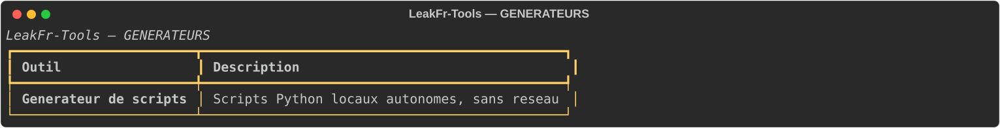

# Générateurs — rapports système autonomes

La catégorie contient **1 outil** : un assembleur de rapports système. Le script produit n'utilise que la bibliothèque standard, ne dépend d'aucun module du projet et n'effectue aucune transmission réseau.

| Outil | Fonction | Aperçu |
|---|---|---|
| Générateur de scripts | Configure et assemble un rapport système multi-sections, l'exporte en JSON, Markdown et HTML, puis propose de l'exécuter ou de le compiler. |  |

## Parcours de génération

### Mode rapide (par défaut)

Deux questions seulement :

1. Nom du script (défaut `rapport-machine.py`).
2. Dossier de sortie (défaut `rapports`).

Puis un aperçu court et une confirmation `oui / configurer / transmettre / annuler`. Les sept sections standards du profil standard sont sélectionnées automatiquement, les options sensibles restent désactivées, et les exports JSON + Markdown sont activés. Si le nom existe déjà, un nom libre (`-1`, `-2`…) est proposé automatiquement.

L'option `transmettre` génère le script, exécute le rapport local, puis ouvre le parcours d'envoi manuel décrit plus bas. Un utilisateur qui ne transmet rien reste sur deux questions.

### Mode avancé

Accessible depuis la confirmation du mode rapide (`configurer`). Les réglages sont regroupés en neuf catégories : sections, système, matériel et stockage, logiciels et développement, réseau, fichiers, session et identifiants, formats et sortie, compilation.

- Saisie multiple en une fois (`1 3 5`), bascule d'une section déjà sélectionnée, `tout` pour les seules sections standards, Entrée pour conserver la sélection.
- Retour à la liste des catégories à tout moment : rien n'est perdu, aucune étape n'est à refaire.
- Un seul récapitulatif avant génération.

### Saisies et robustesse

Les questions passent par des fonctions communes : une réponse vide applique le défaut affiché, une liste ne contenant que `;` ou des espaces vaut une liste vide, un oui/non invalide ou un nombre hors bornes est redemandé, un choix de menu inconnu n'exécute rien. Les noms refusent `<>:"/\|?*` avec un message explicite, et les chemins contenant des espaces sont acceptés.

### Vérification après génération

Le générateur ne déclare pas un succès sur la seule écriture du fichier : il vérifie l'existence, la taille non nulle, la compilation syntaxique (`compile`), la présence de chaque collecteur sélectionné et l'absence des collecteurs désactivés, puis affiche le chemin complet. Une erreur est signalée avec sa cause, sans message de succès génériques.

## Sections disponibles

| Clé | Contenu | Sensible |
|---|---|---|
| `systeme` | OS, version, build, architecture, hôte, démarrage, langue, fuseau. | non |
| `materiel` | Processeur, cœurs, mémoire, fabricant/modèle, GPU détectés. | non |
| `disques` | Points de montage, capacité, espace libre, taux d'utilisation. | non |
| `reseau` | Interfaces, état, adresses privées, passerelle, DNS. | oui |
| `logiciels` | Registre Windows ou `dpkg`, avec limite. | non |
| `dev` | Versions de Python, Git, pip, Node, GCC, .NET, PowerShell. | non |
| `peripheriques` | Compteurs de classes et composants détectés. | non |
| `fichiers` | Inventaire limité avec taille, extension, date, SHA-256. | oui |
| `session` | Utilisateur, domaine, shell, dossier personnel (explicite). | oui |
| `empreinte` | HWID SHA-256, désactivé par défaut. | oui |
| `historique` | Résumé des exports JSON précédents. | non |

Chaque collecteur gère l'absence de données, les permissions refusées et les différences Windows/Linux : il retourne un statut `ok`, `partiel`, `indisponible` ou `erreur`, et une erreur n'interrompt jamais le rapport.

## Formats

- **JSON** — schéma stable `leakfr.system-report.v1`.
- **Markdown** — sommaire, synthèse, tableaux par section, section « Erreurs et limites ».
- **HTML** — autonome, CSS en ligne, aucun script distant.

Les trois formats sont produits à partir du même rapport structuré. Les noms incluent un horodatage et un suffixe numérique en cas de collision : aucun fichier existant n'est écrasé.

## Transmission manuelle (optionnelle)

Aucun script généré n'envoie quoi que ce soit : la transmission est une action distincte, lancée depuis l'application après génération (`transmettre` en mode rapide, ou catégorie **Transmission** en mode avancé).

1. Sélection du rapport JSON présent dans le dossier de sortie.
2. Détection des sections sensibles (empreinte/HWID, session, réseau, fichiers) et choix explicite de les exclure, de tout exclure ou de tout conserver.
3. Aperçu du contenu restant (identifiant, date, sections, statut, taille).
4. Saisie de l'URL de destination, validée (`http`/`https` uniquement) avant l'envoi.
5. Confirmation explicite (`oui`/`non`, réponse inconnue redemandée).
6. Affichage du statut HTTP, de la durée et de l'erreur éventuelle.

Le fichier local n'est jamais modifié ni supprimé, y compris en cas d'échec réseau. Le code réseau est celui de `modules/cyber/webhook_lab.py` (`valider_url`, `valider_timeout`, `envoyer_payload`), sans duplication.

## Compilation

Choisie dans le mode avancé : fichier seul, exécution immédiate, compilation, ou test local suivi d'une proposition de compilation. Le module `build.py` vérifie le script, l'installation de PyInstaller, construit les arguments sans concaténation de chemins, lance le processus avec un délai maximal, contrôle le code de sortie **et** la présence réelle de l'exécutable. Le succès n'est annoncé que si l'artefact existe. Si PyInstaller est absent, la commande `pip install pyinstaller` est proposée sans installation silencieuse. L'exécutable produit n'est jamais lancé automatiquement.

## Limites

- L'inventaire logiciel dépend du registre Windows ou de `dpkg` ; les autres systèmes renvoient `indisponible`.
- Les GPU et périphériques sont détectés via `lspci`, `wmic` ou `/sys` lorsqu'ils sont présents.
- Le script généré n'embarque aucune transmission : l'envoi est toujours une action manuelle de l'application, sur un fichier déjà présent.
- Une transmission échouée ne supprime ni ne modifie le rapport local.
