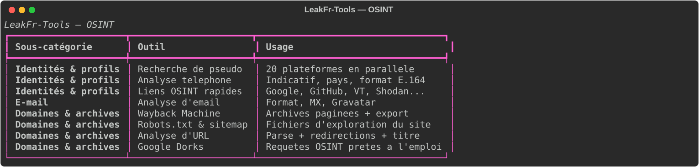
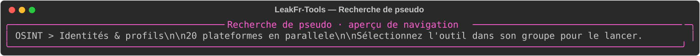
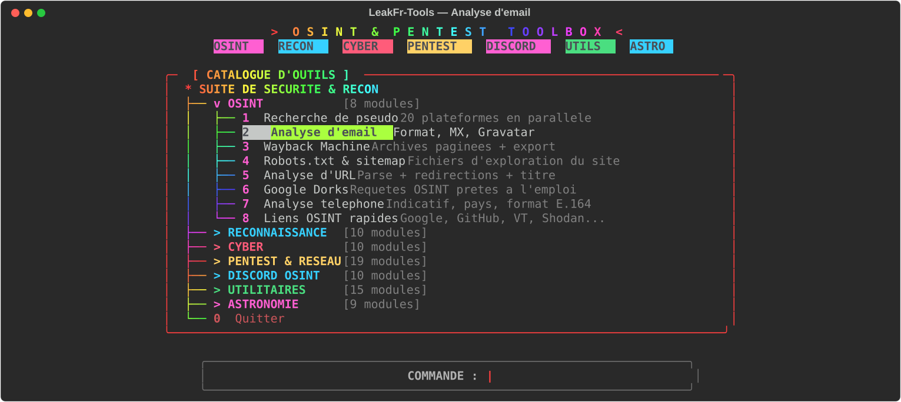
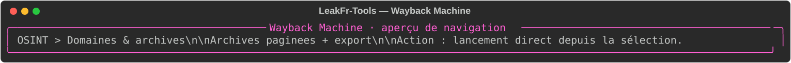
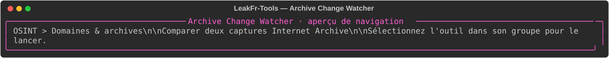
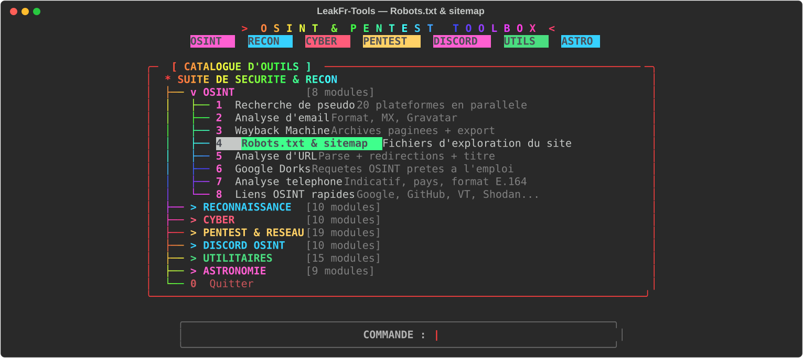
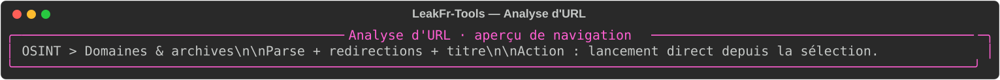
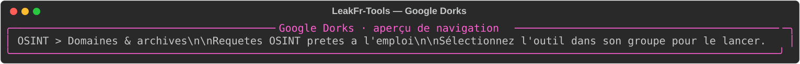
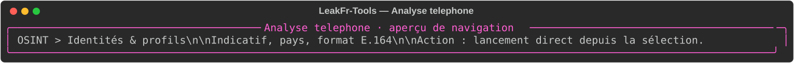
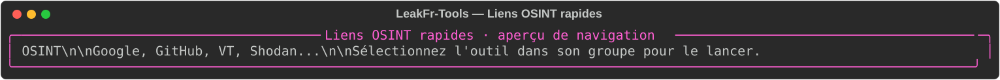

# OSINT — recherches en sources ouvertes

Outils de recherche passive ou de consultation de sources publiques. Les résultats ne prouvent ni l’identité d’une personne ni l’absence d’un compte. Respectez les conditions d’utilisation des sites interrogés.

| Outil | Fonction | Aperçu |
|---|---|---|
| Recherche de pseudo | Vérifie des profils publics sur plusieurs plateformes. |  |
| Analyse d’email | Contrôle le format, les MX et les éléments publics associés. |  |
| Wayback Machine | Recherche des captures archivées d’une URL. |  |
| Archive Change Watcher | Compare deux captures archivées, affiche ajouts/suppressions et exporte JSON ou Markdown. Une différence d’archive reste une observation historique, pas une preuve. |  |
| Robots.txt & sitemap | Consulte les fichiers d’indexation publiés par un site. |  |
| Analyse d’URL | Décompose une URL et inspecte sa réponse/redirection. |  |
| Google Dorks | Compose des requêtes de recherche avancées. |  |
| Analyse téléphone | Affiche indicatif, pays et format normalisé quand possible. |  |
| Liens OSINT rapides | Prépare des liens de recherche publics à partir d’un pseudo. |  |

## Utilisation

Depuis la racine, exécutez `python3 main.py`, choisissez **OSINT**, puis l’outil. Les services distants peuvent limiter ou modifier leurs réponses ; ne saisissez pas de données privées sans base légale.

Les visuels sont des aperçus statiques de l’écran/menu correspondant, pas des résultats de requêtes exécutées.
