# Pentest & réseau — tests autorisés uniquement

Ces diagnostics peuvent émettre des requêtes, sonder des ports ou modifier des ressources. Ne les exécutez que sur vos propres systèmes ou avec une autorisation écrite, dans un périmètre convenu. Une confirmation légale ne remplace pas cette autorisation.

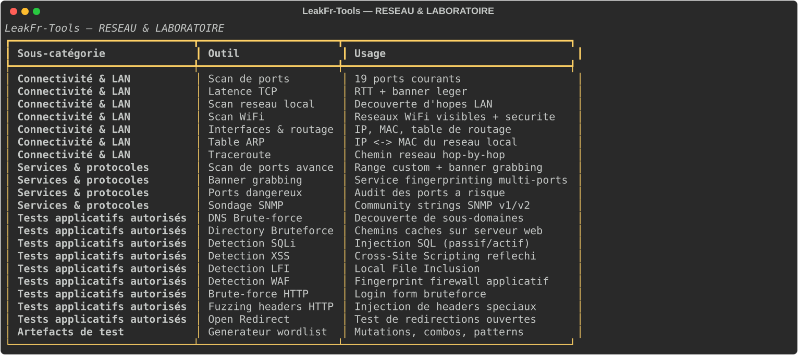

| Outil | Fonction | Aperçu |
|---|---|---|
| Scan de ports avancé | Sonde une plage de ports choisie et récupère éventuellement des bannières. | 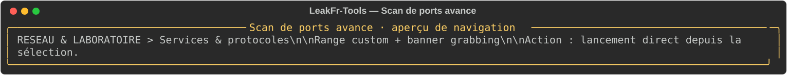 |
| Banner grabbing | Collecte des bannières sur les ports autorisés. | 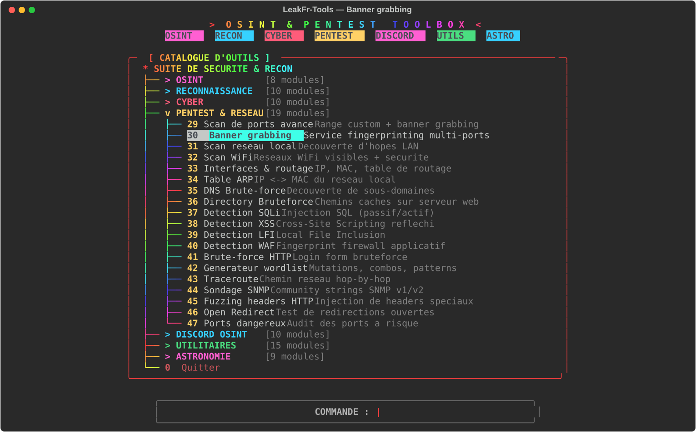 |
| Scan réseau local | Recherche des hôtes répondant sur un réseau local. | 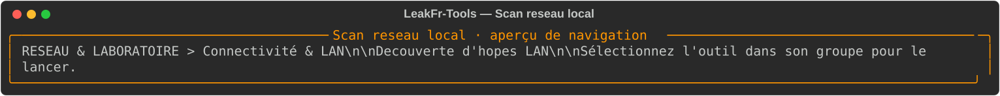 |
| Scan WiFi | Affiche les réseaux détectés selon l’OS et l’interface. | 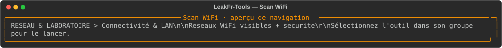 |
| Interfaces & routage | Affiche les interfaces et routes disponibles localement. | 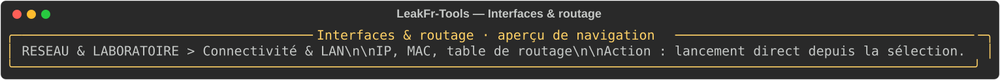 |
| Table ARP | Consulte la table ARP locale du système. | 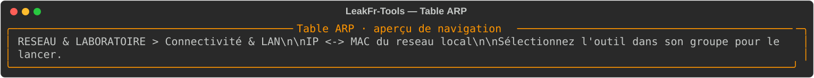 |
| DNS Brute-force | Essaie des noms de sous-domaines sur un domaine autorisé. |  |
| Directory Bruteforce | Vérifie des chemins web à partir d’une wordlist. | 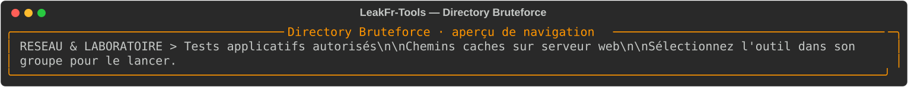 |
| Détection SQLi | Vérifications indicatives de paramètres web contre SQLi. | 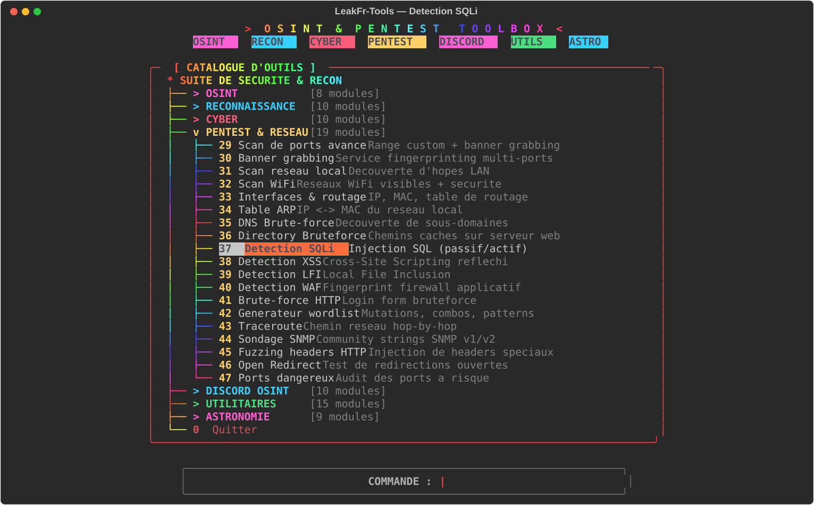 |
| Détection XSS | Recherche indicative de réflexion de charges de test. | 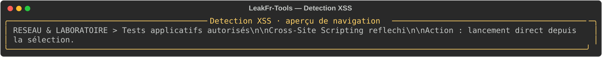 |
| Détection LFI | Vérifie des symptômes d’inclusion de fichiers. | 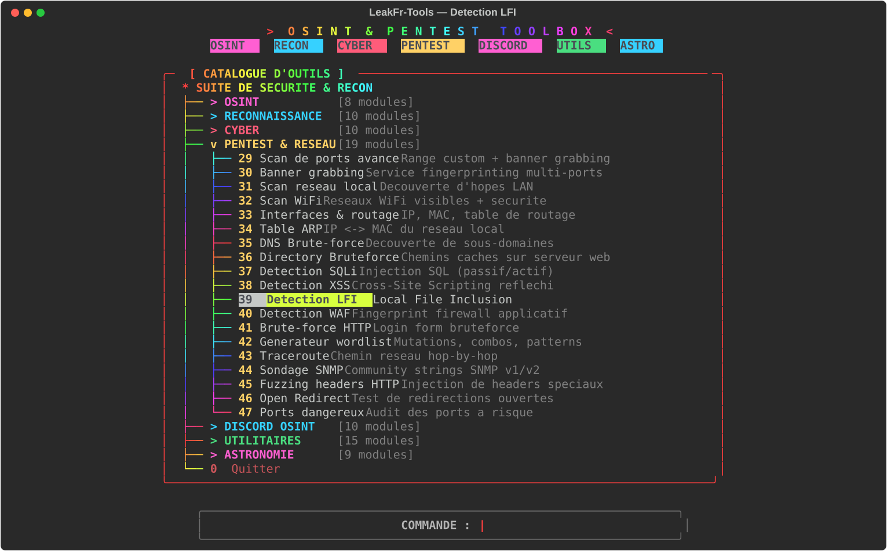 |
| Détection WAF | Signale des indices de filtrage applicatif. | 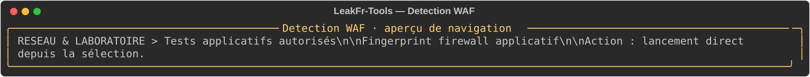 |
| Brute-force HTTP | Détecte le formulaire de login puis teste des mots de passe : à éviter hors laboratoire dédié. | 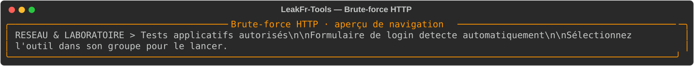 |
| Générateur wordlist | Génère une liste de mots à partir d’entrées fournies. | 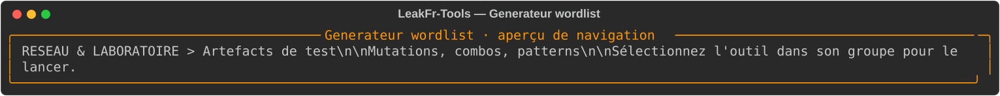 |
| Traceroute | Estime le chemin réseau jusqu’à une destination. | 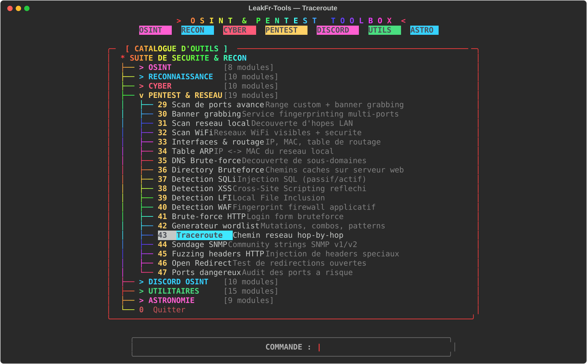 |
| Sondage SNMP | Vérifie des réponses SNMP sur les hôtes autorisés. | 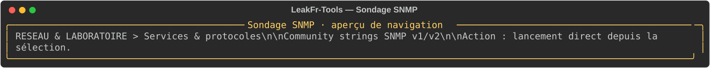 |
| Fuzzing headers HTTP | Essaie des variantes d’en-têtes HTTP sur une cible autorisée. | 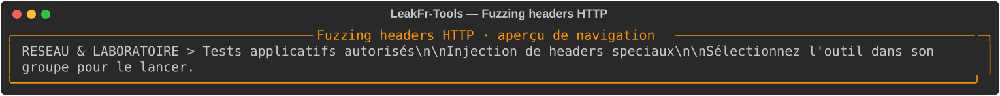 |
| Open Redirect | Recherche des redirections contrôlables dans une URL. | 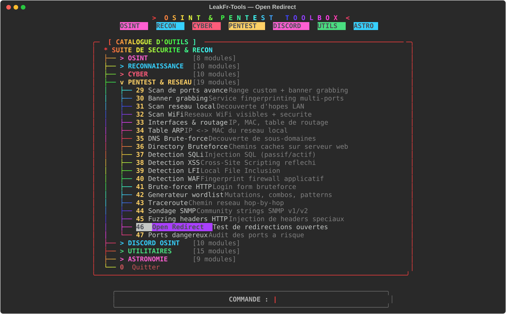 |
| Ports dangereux | Vérifie la présence de ports considérés sensibles. |  |

## Cible automatique

Les outils SQLi, XSS, LFI, Open Redirect, Fuzzing headers et Brute-force HTTP acceptent un **domaine nu** (`exemple.com`) ou une URL complète. Les paramètres sont découverts automatiquement : ceux de l’URL, ceux des liens de la page et ceux des formulaires GET/POST (valeurs par défaut incluses, jetons cachés rejoués), sur la page d’entrée et quelques pages internes. Une URL fournie avec des paramètres reste prioritaire et n’est pas explorée. Le brute-force HTTP détecte le formulaire de connexion (action, méthode, champs identifiant/mot de passe) puis le teste ; si le site construit son formulaire en JavaScript, l’outil demande l’URL exacte du formulaire. Le nombre de paramètres testés est plafonné pour rester rapide et discret.

## Disponibilité selon l’environnement

- **Scan WiFi** : Windows (`netsh`), Linux (`nmcli`/`iwlist`) et macOS (`airport`) uniquement. Sous **Termux/Android, l’énumération WiFi est refusée sans root** : l’outil l’explique au lieu de simuler un résultat.
- **Interfaces & routage** : `ipconfig`/`route` sous Windows, `ip` sous Linux/Termux, `ifconfig`/`netstat` sous macOS. Une commande absente affiche la correction (`pkg install iproute2`, `apt install iproute2 net-tools`…).
- **Table ARP** : utilise `arp` ou `ip neigh` ; la table peut être partielle sous Android sans root.
- **Traceroute** : nécessite `traceroute` (Linux/macOS/Termux) ou `tracert` (Windows). Sous Termux : `pkg install traceroute` ; certains sauts peuvent être bloqués par Android.

Le détail complet et les statuts de test honnêtes figurent dans [`docs/COMPATIBILITE.md`](../../docs/COMPATIBILITE.md). Aucun outil non disponible n’est exécuté : le message est visible et rien n’est simulé.

## Utilisation responsable

Le menu **PENTEST & RESEAU** est accessible dans le catalogue en arbre de `python3 main.py`. Les résultats sont des signaux, pas des preuves de vulnérabilité. N’augmentez pas la cadence pour contourner les limites d’un service. Préférez un laboratoire local et des comptes de test.

Les images sont des aperçus statiques du menu ; aucun scan n’a été réalisé pour les créer.
