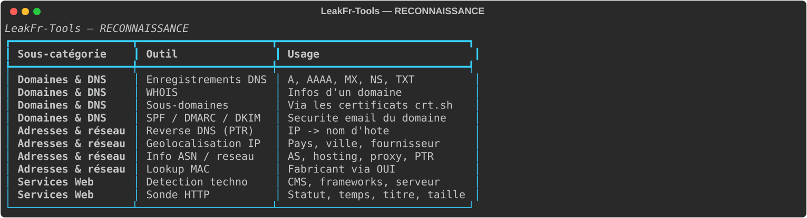
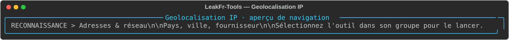
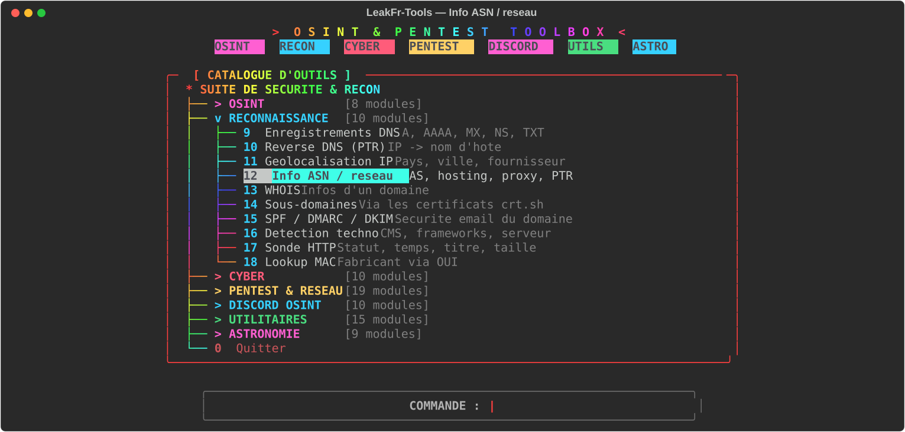
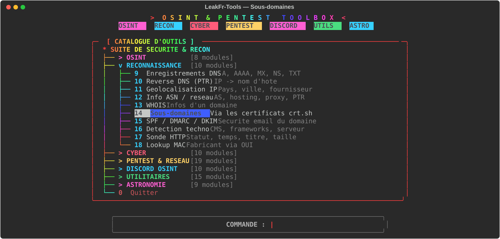
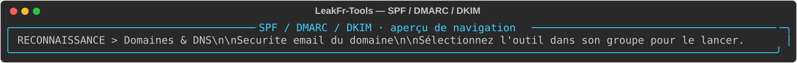
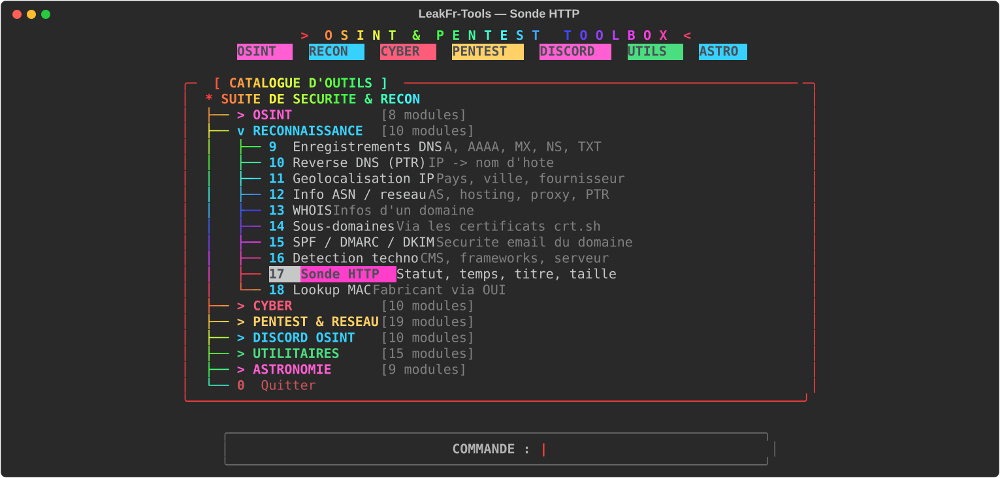

# Reconnaissance — DNS, IP et services

Vérifications techniques et données de sources publiques. Une adresse IP ou un domaine doit être celui d’un actif que vous êtes autorisé à examiner.

| Outil | Fonction | Aperçu |
|---|---|---|
| Enregistrements DNS | Interroge les enregistrements A, AAAA, MX, NS et TXT. |  |
| Reverse DNS (PTR) | Cherche le nom associé à une adresse IP. |  |
| Géolocalisation IP | Estime le pays/la région via un service tiers. |  |
| Info ASN / réseau | Recherche l’ASN et des informations publiques réseau. |  |
| WHOIS | Consulte les informations d’enregistrement disponibles. |  |
| Sous-domaines | Recherche des noms publiés dans les certificats publics. |  |
| SPF / DMARC / DKIM | Examine les mécanismes de sécurité mail publiés en DNS. |  |
| Détection techno | Signale des technologies web détectables publiquement. |  |
| Sonde HTTP | Vérifie statut, latence et métadonnées HTTP simples. |  |
| Lookup MAC | Cherche le fabricant correspondant à un préfixe OUI. |  |

## Utilisation

Démarrez `python3 main.py`, ouvrez **RECONNAISSANCE** et sélectionnez l’outil. Les données de géolocalisation et WHOIS sont indicatives et peuvent être incomplètes ou anciennes.

Les visuels sont des aperçus statiques du menu, sans requête réseau exécutée.
