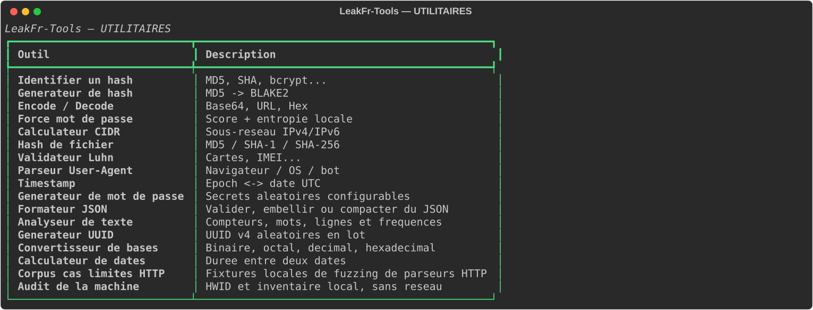
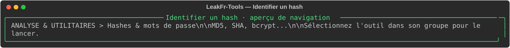
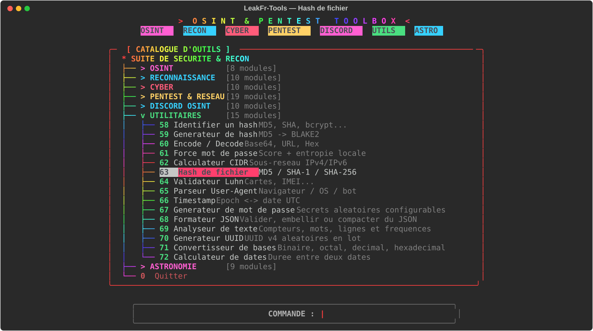
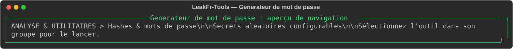
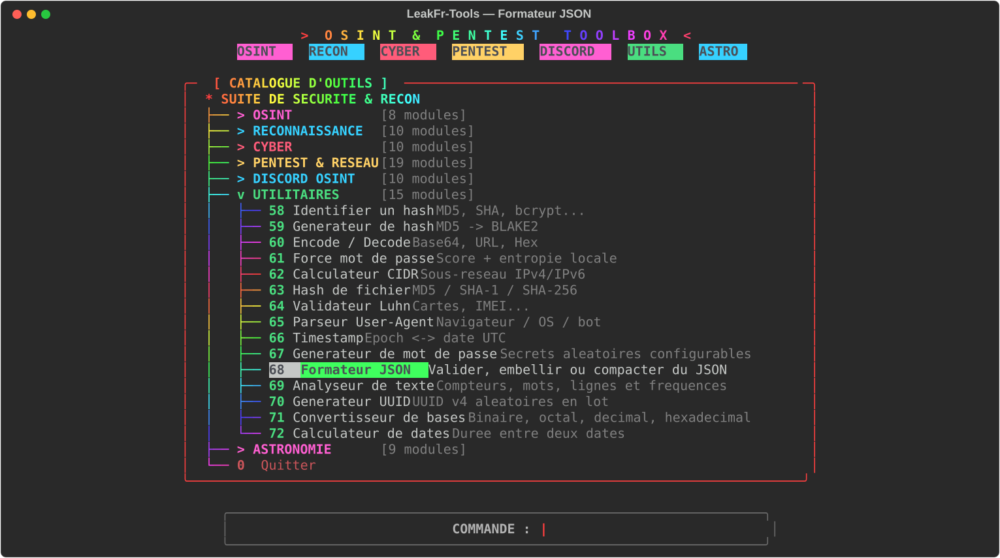
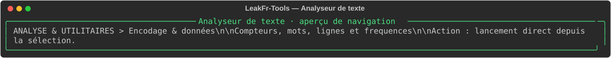
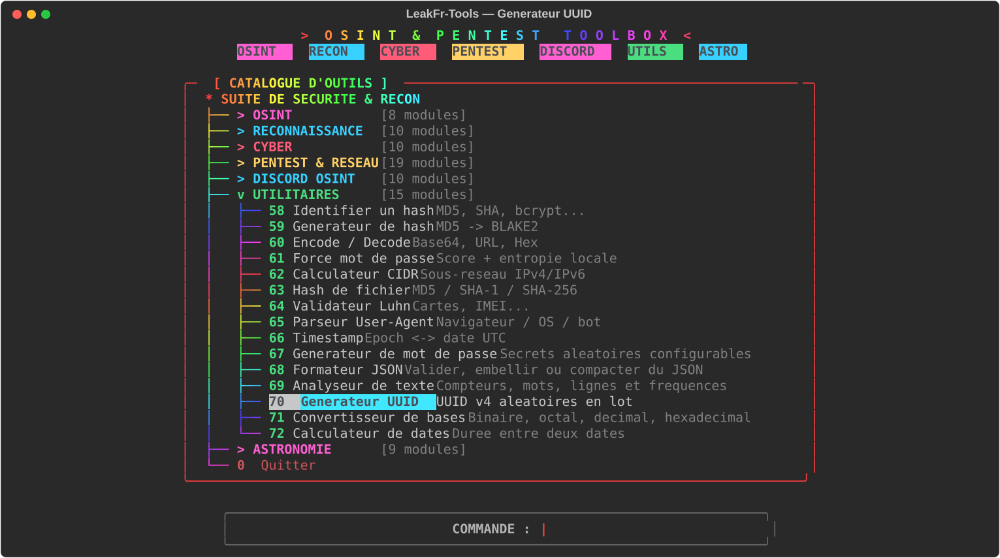
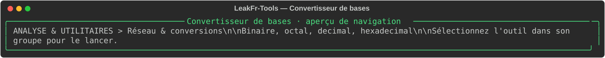
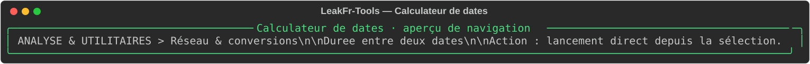

# Utilitaires — transformations locales

La suite contient maintenant **15 outils**. Tous les nouveaux calculateurs fonctionnent localement et n’ajoutent aucune dépendance.

Outils essentiellement locaux pour les formats, checksums, valeurs numériques et informations de texte. Les mots de passe saisis ne doivent pas être réutilisés ; le score de robustesse est une estimation.

| Outil | Fonction | Aperçu |
|---|---|---|
| Identifier un hash | Estime les formats de hash compatibles à partir de leur apparence. |  |
| Générateur de hash | Calcule plusieurs digests d’une chaîne fournie. |  |
| Encode / Decode | Encode ou décode Base64, URL et hex. |  |
| Force mot de passe | Estime la diversité et l’entropie d’un secret localement. |  |
| Calculateur CIDR | Calcule réseau, plage et hôtes IPv4/IPv6. |  |
| Hash de fichier | Calcule des checksums de fichier sans modifier la source. |  |
| Validateur Luhn | Vérifie le checksum Luhn d’une valeur numérique. |  |
| Parseur User-Agent | Identifie des indices de navigateur, OS ou robot dans un UA. |  |
| Timestamp | Convertit des timestamps et dates UTC. |  |
| Générateur de mot de passe | Génère localement un secret aléatoire configurable, masqué par défaut. |  |
| Formateur JSON | Valide puis formate ou compacte un texte JSON. |  |
| Analyseur de texte | Calcule localement des compteurs et termes fréquents. |  |
| Générateur UUID | Génère des UUID v4 locaux en lot. |  |
| Convertisseur de bases | Convertit des entiers entre binaire, octal, décimal et hexadécimal. |  |
| Calculateur de dates | Calcule une différence ou un décalage entre dates. |  |

## Utilisation

Lancez `python3 main.py` et choisissez **UTILITAIRES**. N’entrez pas de secrets de production : même sans sauvegarde, un terminal ou une capture peut conserver les entrées.

Les illustrations sont des aperçus statiques du menu, sans données réelles.
